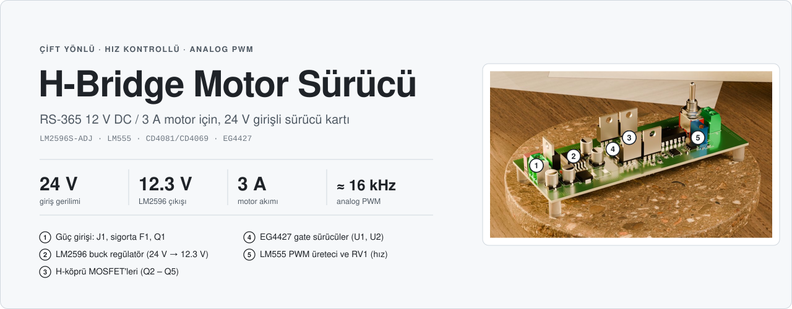
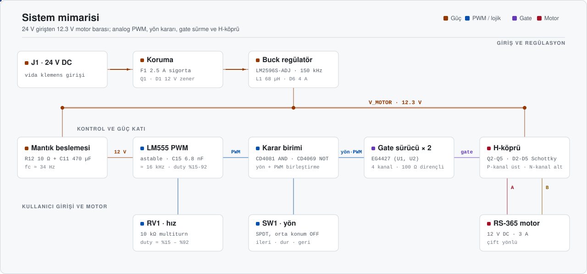
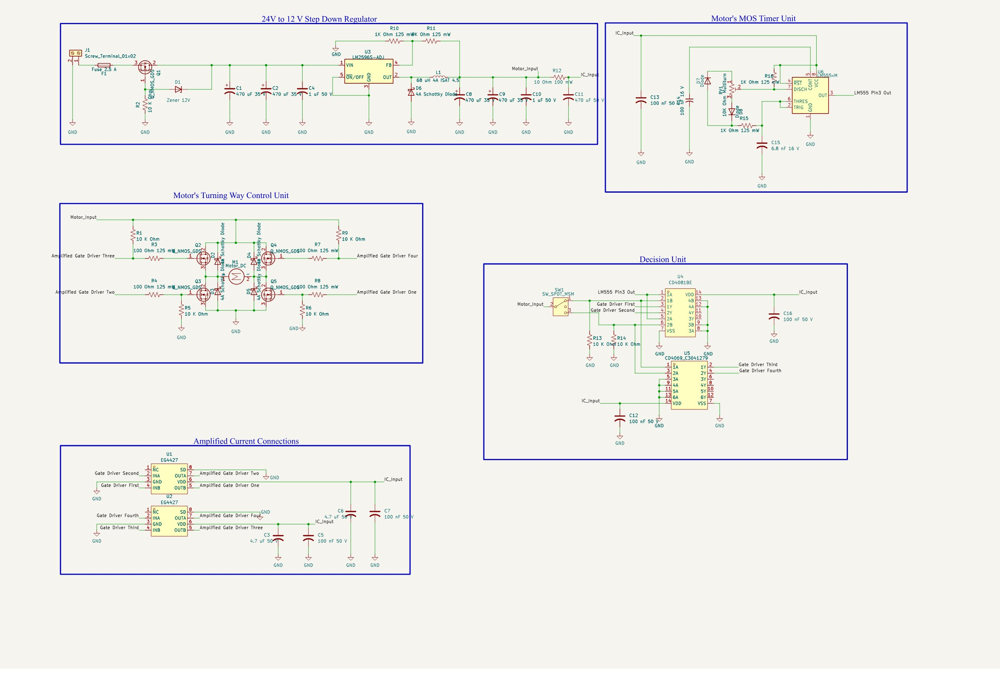
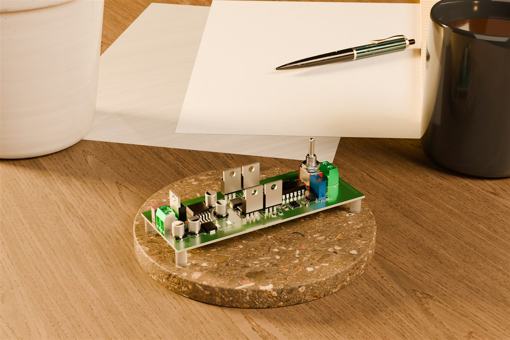
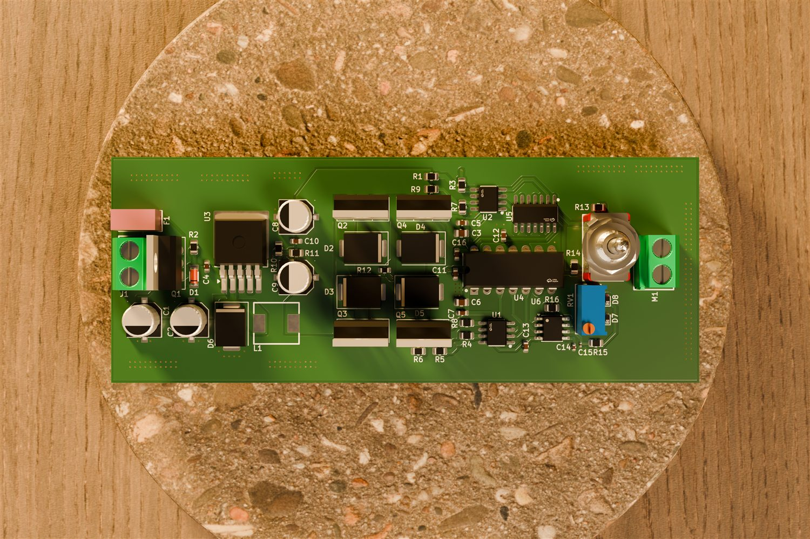

<div align="center">



<br/>

<a href="#-donanım"></a>
<a href="#-donanım"></a>
<a href="#-donanım"></a>


<br/><br/>

**Mikrodenetleyicisiz, tamamen analog PWM ile çalışan çift yönlü motor sürücü.**<br/>
24 V girişten 12.3 V motor barası üretir; hızı bir trimpotla, yönü bir anahtarla ayarlanır.

</div>


## İçindekiler

- [Genel bakış](#-genel-bakış)
- [Öne çıkanlar](#-öne-çıkanlar)
- [Sistem mimarisi](#-sistem-mimarisi)
- [Çalışma prensibi](#-çalışma-prensibi)
- [Donanım](#-donanım)
- [Tasarım hesapları](#-tasarım-hesapları)
- [Bilinen sorunlar ve RevB'de düzeltilecekler](#-bilinen-sorunlar-ve-revbde-düzeltilecekler)
- [Şematik](#-şematik)
- [PCB](#-pcb)
- [Malzeme listesi](#-malzeme-listesi)
- [Depo yapısı](#-depo-yapısı)

## ◆ Genel bakış

Bu proje, bir önceki çalışmamda kullandığım **RS-365 serisi 12 V DC / 3 A** motoru **çift yönlü** ve **hız kontrollü** sürmek için tasarlanmış bir H-köprü kartıdır. Güç tarafında 24 V DC girişten **LM2596S-ADJ** ile 12.3 V'luk motor barası üretilir. PWM sinyali mikrodenetleyici olmadan **LM555** ile, yön kararı **CD4081 / CD4069** mantık kapılarıyla verilir; köprüyü iki adet **EG4427** gate sürücü besler.

| Özellik | Değer |
|---|---|
| **Giriş** | 24 V DC · vida klemens (J1) · 2.5 A sigorta (F1) |
| **Motor barası** | 12.3 V · LM2596S-ADJ, R10 1 kΩ / R11 9 kΩ geri besleme |
| **Motor** | RS-365 · 12 V DC · 3 A |
| **Regülatör** | L1 68 µH (ISAT 4.5 A) · D6 4 A Schottky · çıkışta C8, C9 470 µF 35 V |
| **PWM** | LM555 astable · C15 6.8 nF · hesaplanan ≈ 16 kHz · duty ≈ %15 – %92 |
| **Hız ayarı** | RV1 10 kΩ multiturn trimpot |
| **Yön** | SW1 SPDT, orta konumda dur · CD4081 (AND) + CD4069 (NOT) |
| **Gate sürücü** | 2 × EG4427 · MOSFET başına 100 Ω gate direnci |
| **Köprü** | Q2, Q4 P-kanal (üst) · Q3, Q5 N-kanal (alt) · TO-220 · her birine paralel 4 A Schottky |
| **Kart** | 115.65 × 44.48 mm · 4 katmanlı · 1.6 mm |

## ◆ Öne çıkanlar

<table>
<tr>
<td width="50%" valign="top">

**Tamamen analog PWM**<br/>
Frekans ve duty bir LM555 ile üretilir. İki diyot şarj ve deşarj yollarını ayırdığı için trimpot yalnızca duty'yi değiştirir; toplam direnç sabit kaldığından frekans yaklaşık sabittir.

</td>
<td width="50%" valign="top">

**Giriş koruması**<br/>
2.5 A sigorta, P-kanal giriş MOSFET'i (Q1) ve gate'i 12 V zener (D1) ile sınırlanmış koruma devresi. Sigorta 24 V tarafında olduğu için 3 A motor akımı, giriş tarafında yaklaşık 1.8 A'e karşılık gelir (%85 verim varsayımıyla).

</td>
</tr>
<tr>
<td valign="top">

**Gate sürücü ile hızlı anahtarlama**<br/>
Mantık kapıları gate'i doğrudan sürecek akımı veremez. İki EG4427, gate'leri 100 Ω dirençler üzerinden besler; her MOSFET'te 10 kΩ pull-up / pull-down açılış anında gate'i kapalı tutar.

</td>
<td valign="top">

**Her MOSFET'e Schottky diyot**<br/>
D2 – D5 (4 A, SMC), PWM kapalıyken motor akımının dolaşacağı yolu açar ve MOSFET gövde diyotlarını rahatlatır.

</td>
</tr>
</table>

## ◆ Sistem mimarisi

<p align="center">
  
</p>

Güç yolu soldan sağa akıyor: 24 V giriş sigortadan, giriş koruma devresinden (Q1, D1) ve LM2596'dan geçip 12.3 V'luk `V_MOTOR` barasına ulaşıyor. Bu baradan iki kol ayrılıyor:

- **Mantık beslemesi** · 10 Ω (R12) ve 470 µF (C11) ile süzülerek LM555, CD4081, CD4069 ve EG4427'leri besler (kesim frekansı ≈ 34 Hz).
- **H-köprü** · MOSFET'ler ve motor doğrudan bu baradan beslenir.

PWM, yön bilgisiyle kapılarda birleştirilir; EG4427'ler sinyali güçlendirip köprünün dört MOSFET'ine iletir.

## ◆ Çalışma prensibi

<p align="center">
  
</p>

Köprünün her bacağında bir P-kanal (üst) ve bir N-kanal (alt) MOSFET vardır; motor iki bacağın orta noktaları arasına bağlanır.

- **İleri:** Q2 sabit iletimde, Q5 PWM ile anahtarlanır. Akım `V_MOTOR → Q2 → motor → Q5 → GND` yolunu izler.
- **Geri:** Q4 sabit iletimde, Q3 PWM ile anahtarlanır. Akım motordan ters yönde geçer.
- **Dur:** SW1 orta konumdayken tüm çıkışlar pasiftir.
- **Hız:** Motora uygulanan ortalama gerilim $V_{ort} \approx D \times 12.3\text{ V}$ olur; RV1 duty'yi değiştirir.

Üst kolda P-kanal MOSFET'ler kullanılmıştır: gate'e GND yakın bir gerilim verildiğinde açılırlar, gate'leri pull-up dirençleriyle motor barasına bağlı olduğundan boşta kapalı kalırlar ve böylece üst kol için ayrıca bir bootstrap devresi gerekmez.

## ◆ Donanım

<details open>
<summary><b>Güç girişi ve regülatör</b></summary>
<br/>

| Blok | Parça | Not |
|---|---|---|
| Giriş | J1 vida klemens (MX126-5.0-02P, C5188434; 5.00 mm, 10 A, 300 V) · F1 2010T2.5A250V (C354903; 2.5 A, 300 V DC) | Sigorta 24 V tarafında |
| Giriş koruma MOSFET'i | Q1 (P-kanal, TO-220) · R2 10 kΩ · D1 ZMM12V (C5345999; 11.4 – 12.7 V, 500 mW) | Gate R2 ile GND'ye çekili, zener V<sub>GS</sub>'i sınırlar |
| Regülatör | U3 LM2596S-ADJ | R10 1 kΩ / R11 9 kΩ → 12.3 V |
| Bobin | L1 SMMS0865-680MT · 68 µH (C42443515) | ISAT 4.5 A · Irms 4 A · DCR 180 mΩ · 9 × 8.1 mm |
| Diyot | D6 4 A Schottky (SMC) | Serbest dolaşım |
| Giriş kondansatörleri | C1, C2 470 µF 35 V (şematik değeri) · C4 1 µF | Anahtarlama anındaki ani akımı karşılar. Kütüphane kaydı (LCSC C335982) ROQANG RVT1A471M0607 = 470 µF / **10 V**, 6.3 × 7.7 mm'dir |
| Çıkış kondansatörleri | C8, C9 470 µF 35 V (şematik değeri) · C10 1 µF | Hızlı tepki için seramik, süreğen düşüşler için polarize; C8 / C9 için de aynı kütüphane parçası (10 V) geçerlidir |

</details>

<details>
<summary><b>PWM üretimi — LM555</b></summary>
<br/>

- Astable modda çalışır; C15 = 6.8 nF kondansatör Vcc'nin 1/3 ile 2/3'ü arasında şarj/deşarj olur.
- D7 ve D8 diyotları şarj ve deşarj akımlarını RV1'in iki farklı yarısından geçirir. Şarj yolu: `R16 + RV1(üst) + R15`, deşarj yolu: `RV1(alt) + R15`.
- Toplam direnç RV1'in konumundan bağımsızdır; bu yüzden frekans sabit kalır, yalnızca duty değişir.
- C13 ve C14 besleme / kontrol pini dekuplaj kondansatörleridir.

</details>

<details>
<summary><b>Karar birimi — SW1, CD4081, CD4069</b></summary>
<br/>

- SW1 üç konumlu (orta konumda OFF) bir SPDT anahtardır; seçilen yön hattı 12 V'a çekilirken diğeri R13 / R14 (10 kΩ) ile GND'de tutulur.
- **CD4081** (dörtlü AND) yön bilgisini LM555 PWM çıkışıyla birleştirir.
- **CD4069** (altılı NOT) yön hatlarını tersleyerek üst kol P-kanal MOSFET'lerin (Q2, Q4) gate sinyalini üretir; CD4081 çıkışları ise alt kol (Q3, Q5) sürücüsüne gider.
- Mantık beslemesi (`IC_Input`) 10 Ω + 470 µF ile süzülen 12.3 V barasından gelir; 4000 serisi CMOS bu gerilimde çalışır.

</details>

<details>
<summary><b>Gate sürücü — EG4427</b></summary>
<br/>

- İki entegre, dört MOSFET gate'ini sürer (INA / INB → OUTA / OUTB).
- Her entegrenin beslemesinde 4.7 µF + 100 nF bulunur.
- Çıkışlar 100 Ω (R3, R4, R7, R8) gate dirençleriyle MOSFET'lere gider.
- Üst kol gate'leri 10 kΩ (R1, R9) ile motor barasına, alt kol gate'leri 10 kΩ (R5, R6) ile GND'ye bağlıdır.

</details>

<details>
<summary><b>Motor köprüsü</b></summary>
<br/>

| Ref | Tür | Görev |
|---|---|---|
| Q2, Q4 | P-kanal, TO-220 | Üst kol, yön seçimi |
| Q3, Q5 | N-kanal, TO-220 | Alt kol, PWM |
| D2 – D5 | 4 A Schottky, SMC | Her MOSFET'e paralel serbest dolaşım diyodu |
| M1 | Vida klemens | Motor bağlantısı |

</details>

## ◆ Tasarım hesapları

> Değerler KiCad şematik / PCB dosyalarından (RevA), TI LM2596 (SNVS124G) ve LM555 (SNAS548D) datasheet'lerinden ve EG4427'nin LCSC ürün sayfasından alınmıştır. MOSFET'lerin parça numarası şematikte yazılı olmadığı için MOSFET hesapları gereksinim düzeyindedir; datasheet'te karşılığı olmayan değerler "varsayım" diye işaretlenmiştir.

<details>
<summary><b>Giriş akımı ve sigorta</b></summary>
<br/>

$$P_{OUT} = 12.3\text{ V} \times 3\text{ A} = 36.9\text{ W} \quad\Rightarrow\quad I_{IN} = \frac{36.9\text{ W}}{\eta \times 24\text{ V}} = 1.71\text{ A}\ (\eta = 0.90),\quad 1.81\text{ A}\ (\eta = 0.85)$$

η = %90, LM2596 datasheet'inin 25 V → 12 V, 3 A noktasındaki tipik verimidir (7.7). 2.5 A sigorta bu akımın ≈ 1.4 katıdır; sigortanın sürekli akımda anma değerinin %75'inde (1.9 A) çalıştırılması kuralıyla 1.7 – 1.8 A sınırın içindedir. Motorun kalkış / sıkışma akımı 3 A'i belirgin aşarsa sigorta ve LM2596'nın akım sınırı devreye girer (rotor kilitli akımı bu belgede verilmemiştir).

</details>

<details>
<summary><b>Giriş koruma devresi (Q1, D1, R2)</b></summary>
<br/>

Q1'in gate'i R2 (10 kΩ) ile GND'ye çekilidir; D1 (12 V zener) gate ile drain arasında, gate gerilimini drain gerilimine göre en fazla 12 V aşağıda tutar:

$$V_{GS} \approx -12\text{ V}\ (\text{iletimde}), \qquad I_{R2} = \frac{24 - 12}{10\text{ k}\Omega} = 1.2\text{ mA}, \qquad P_{R2} = P_{D1} = 12\text{ V} \times 1.2\text{ mA} = 14.4\text{ mW}$$

R2 için bu, 0805'in 125 mW değerinin %12'sidir. Q1 üzerindeki iletim kaybı $P = I_{IN}^2 R_{DS(on)}$: 1.8 A ve 50 mΩ için 0.16 W. Q1 için $V_{DS} \ge 40\text{ V}$ (60 V önerilir) gerekir. Başlangıçta drain 0 V iken gate geçici olarak 0 V'ta kaldığından $V_{GS}$ kısa süreliğine −24 V'a ulaşır (zener drain 12 V'u aştıktan sonra iletime geçer); bu nedenle gate–source sınırı ±20 V'tan yüksek bir parça tercih edilmelidir.

**Giriş kondansatörleri (C1, C2):** toplam 940 µF; depolanan enerji $\tfrac{1}{2} C V^2 = \tfrac{1}{2} \cdot 940\ \mu\text{F} \cdot 24^2 = 0.27\text{ J}$. LM2596 datasheet'i RMS akımın $\ge I_{LOAD}/2 = 1.5\text{ A}$ (iki kondansatör için her biri ≥ 0.75 A) ve gerilim değerinin $\approx 1.5 \times V_{IN} = 36\text{ V}$ olmasını ister (9.2.2.2.6); 35 V'luk kondansatör 24 V'ta gerilim değerinin %69'unda çalışır.

**Parça doğrulaması (C1, C2, C8, C9):** şematik değeri 470 µF / 35 V'tur, ancak footprint ve 3B model kütüphanedeki LCSC C335982 kaydından gelir: ROQANG RVT1A471M0607, **470 µF / 10 V**, 6.3 × 7.7 mm, dalgalanma akımı 200 mA @ 120 Hz. 6.3 mm gövdeli SMD kutuda 470 µF yalnızca 6.3 – 10 V'ta bulunur; 470 µF / 35 V standart alüminyum elektrolitikte ≈ 10 × 10 mm veya daha büyük kutu gerektirir. 10 V'luk bu parça 24 V (C1, C2) ve 12.3 V (C8, C9) baralarında kullanılamaz. Ayrıca LM2596 girişindeki RMS akım $I_{RMS} = I_{LOAD}\sqrt{D(1-D)} = 3\sqrt{0.548 \cdot 0.452} = 1.49\text{ A}$'dir; iki kondansatörün toplam 0.4 A'lik dalgalanma akımı bunun çok altındadır. 35 V'luk gerçek kondansatörler için footprint değiştirilmelidir.

**C11 (470 µF / 50 V):** footprint 0603 (1.6 × 0.8 mm) olarak atanmıştır; bu değerde bir kondansatör 0603 kılıfta bulunmaz, footprint gerçek parçaya göre düzeltilmelidir.

</details>

<details>
<summary><b>Çıkış gerilimi (12.3 V)</b></summary>
<br/>

$$V_{OUT} = V_{REF} \times \left(1 + \frac{R_{11}}{R_{10}}\right) = 1.23\text{ V} \times \left(1 + \frac{9\text{ k}\Omega}{1\text{ k}\Omega}\right) = 12.3\text{ V}$$

R10 = 1 kΩ, datasheet'in 240 Ω – 1.5 kΩ aralığındadır. Referans toleransıyla (1.193 – 1.267 V) çıkış 11.93 – 12.67 V arasında olabilir (≈ ±%3).

</details>

<details>
<summary><b>Bobin akımı ve akım sınırı</b></summary>
<br/>

Datasheet'in duty ifadesi (Denklem 8; $V_{SAT} = 1.16\text{ V}$, $V_D = 0.5\text{ V}$), 150 kHz ve $L = 68\ \mu\text{H}$ için:

$$D = \frac{12.3 + 0.5}{24 - 1.16 + 0.5} = 0.548, \qquad \Delta I_L = \frac{(24 - 1.16 - 12.3) \times 0.548}{150\text{ kHz} \times 68\ \mu\text{H}} = 0.57\text{ A}$$

$$I_{pk} = 3 + \frac{0.57}{2} = 3.28\text{ A}, \qquad E \cdot T = 38.5\text{ V}\cdot\mu\text{s}$$

Tepe akım, bobinin ISAT değerinin (4.5 A) %73'üdür.

Yük akımı $\Delta I_L / 2 = 0.28\text{ A}$'in altına düşerse regülatör süreksiz moda geçer. LM2596'nın akım sınırı tipik 4.5 A, en az 3.6 A olduğundan sürekli ortalama yük akımı üst sınırı $I_{CL} - \Delta I_L/2 = 3.3\text{ A}$ (en kötü) – 4.2 A (tipik) olur.

</details>

<details>
<summary><b>Serbest dolaşım diyodu (D6) ve çıkış kondansatörleri</b></summary>
<br/>

D6 için datasheet kuralları (9.2.2.2.5): akım ≥ 1.3 × 3 A = 3.9 A (4 A'lik diyot sağlar), ters gerilim ≥ 1.25 × 24 V = 30 V (şematikte yalnızca "4A Schottky" yazılıdır). Normal çalışmada $I_D = 3 \times (1 - 0.548) = 1.35\text{ A}$, $P_D = 0.5 \times 1.35 = 0.68\text{ W}$.

Çıkış kondansatörü için datasheet 82 – 820 µF aralığını ve $\ge 1.5 \times V_{OUT}$ gerilimi ister (9.2.2.2.3). Kartta C8 + C9 = 940 µF'tır (35 V, 18.5 V kuralını sağlar) ve ayrıca R12 üzerinden C11 (470 µF) bağlıdır:

$$f_0 = \frac{1}{2\pi\sqrt{68\ \mu\text{H} \times 940\ \mu\text{F}}} \approx 630\text{ Hz}$$

Çıkış 10 V'un üzerinde olduğundan datasheet $C_{FF} = 1/(31 \cdot 10^3 \cdot R_{11}) \approx 3.6\text{ nF}$ önerir (Tablo 9-6: 12 V için 1 nF); kartta yoktur.

</details>

<details>
<summary><b>LM2596 güç kaybı ve ısıl kontrol</b></summary>
<br/>

İletim modeli: $P_{IC} = 1.16 \times 3 \times 0.548 + 24 \times 5\text{ mA} = 2.03\text{ W}$. Bütçe yöntemi: datasheet'in tipik %90 verimiyle toplam kayıp $36.9 / 0.9 - 36.9 = 4.1\text{ W}$; D6'nın 0.68 W'ı ve L1'in bakır kaybı $I^2 \times DCR = 3^2 \times 0.18\ \Omega = 1.62\text{ W}$ (SMMS0865-680MT, DCR 180 mΩ; LCSC C42443515) düşülürse entegreye $4.1 - 0.68 - 1.62 = 1.80\text{ W}$ kalır; iki yöntem birbirine yakındır. Kart alanı $115.65 \times 44.48 = 5144\text{ mm}^2 \approx 7.97\text{ in}^2$ (4 katman); R<sub>θJA</sub>'nın 20 – 30 °C/W olacağı varsayıldı (datasheet 7.4: 3 in² çift yüzlü → 20, 2.5 in² tek yüzlü → 30 °C/W):

| P<sub>IC</sub> | R<sub>θJA</sub> = 20 °C/W | R<sub>θJA</sub> = 30 °C/W |
|---|---|---|
| 1.80 W (bütçe) | T<sub>J</sub> = 76 °C | T<sub>J</sub> = 94 °C |
| 2.03 W (iletim modeli) | T<sub>J</sub> = 81 °C | T<sub>J</sub> = 101 °C |

İşletme sıcaklığı üst sınırı 125 °C'dir (7.3); her iki yöntemde de ≤ 101 °C'tir. L1 bobininin tam yükteki 1.62 W'lık kaybı (Irms 4 A, sınırın %75'inde çalışır) ayrıca karta ısı verir.

</details>

<details>
<summary><b>PWM frekansı ve duty aralığı (LM555)</b></summary>
<br/>

D7 / D8 şarj ve deşarj yollarını ayırır: şarj $R_{16} + R_a + R_{15}$, deşarj $R_b + R_{15}$ üzerinden ($R_a + R_b = R_{RV1} = 10\text{ k}\Omega$). Datasheet formülleri (7.4.2):

$$t_H = 0.693\,(R_{16} + R_a + R_{15})\,C_{15}, \qquad t_L = 0.693\,(R_b + R_{15})\,C_{15}$$

$$T = 0.693\,(R_{16} + R_{RV1} + 2R_{15})\,C_{15} = 0.693 \times 13\text{ k}\Omega \times 6.8\text{ nF} = 61.3\ \mu\text{s} \;\Rightarrow\; f \approx 16.3\text{ kHz}$$

$$D_{min} = \frac{R_{16} + R_{15}}{R_{16} + R_{RV1} + 2R_{15}} = \frac{2}{13} = 15\%, \qquad D_{max} = \frac{12}{13} = 92\%$$

Frekans RV1'in konumundan bağımsızdır. Diyot düşümü ($V_F = 0.6\text{ V}$, varsayım) dahil edildiğinde ($V_{CC} = 12.3\text{ V}$; kondansatör $V_{CC}/3$ ile $2V_{CC}/3$ arasında):

| R<sub>a</sub> | 0 | 2.5 kΩ | 5 kΩ | 7.5 kΩ | 10 kΩ |
|---|---|---|---|---|---|
| D (ideal) | %15 | %35 | %54 | %73 | %92 |
| f (V<sub>F</sub> = 0.6 V) | 17.4 kHz | 16.7 kHz | 16.0 kHz | 15.4 kHz | 14.8 kHz |
| D (V<sub>F</sub> = 0.6 V) | %18 | %40 | %59 | %77 | %94 |

LM555 astable başlangıç doğruluğu %2.25'tir (6.5). Deşarj sırasında pin 7 yaklaşık 0.15 V'a iner ve R16'dan $(12.3 - 0.15)/1\text{ k}\Omega = 12.2\text{ mA}$ akar (anlık 148 mW); ortalama güç $148\text{ mW} \times (1 - D)$: D ≈ %18'de 121 mW, D ≈ %94'te 9 mW. 0805 direncin anma gücü 125 mW'tır, yani en düşük duty'de R16 anma gücünün %97'sini harcar.

</details>

<details>
<summary><b>Motora uygulanan ortalama gerilim</b></summary>
<br/>

$$V_{avg} \approx D \times 12.3\text{ V}:\qquad D = 15\% \Rightarrow 1.8\text{ V},\quad 25\% \Rightarrow 3.1\text{ V},\quad 50\% \Rightarrow 6.2\text{ V},\quad 75\% \Rightarrow 9.2\text{ V},\quad 92\% \Rightarrow 11.3\text{ V}$$

</details>

<details>
<summary><b>Mantık beslemesi filtresi</b></summary>
<br/>

$$f_c = \frac{1}{2\pi \times R_{12} \times C_{11}} = \frac{1}{2\pi \times 10\ \Omega \times 470\ \mu\text{F}} \approx 34\text{ Hz}$$

Besleme akımı yaklaşık 17 – 20 mA'dir (LM555 ≈ 8 mA, R16 ortalama ≈ 6 mA, pull-up / pull-down'lar 1 – 2.5 mA, gate akımları); R12 üzerindeki düşüm en fazla $20\text{ mA} \times 10\ \Omega = 0.2\text{ V}$'tur ve mantık beslemesi ≈ 12.1 V olur. LM555 için önerilen aralık 4.5 – 16 V'tur.

</details>

<details>
<summary><b>Gate sürücü (EG4427)</b></summary>
<br/>

EG4427 (LCSC C2929102): 3 – 20 V besleme, 1.5 A tepe akım, t<sub>pHL</sub> = 60 ns / t<sub>pLH</sub> = 80 ns. Gate dirençleri 100 Ω olduğundan:

$$I_{pk} = \frac{V_{DD}}{R_g} = \frac{12.3\text{ V}}{100\ \Omega} = 123\text{ mA} \ll 1.5\text{ A}, \qquad R_{g,min} = \frac{12.3\text{ V}}{1.5\text{ A}} = 8.2\ \Omega$$

Gate dolma süresi $t \approx Q_g / I_{pk}$ ve ortalama gate gücü $P = Q_g V_{DD} f$ ($f = 16.3\text{ kHz}$; Q<sub>g</sub> örnek değerlerdir):

| Q<sub>g</sub> (örnek) | 20 nC | 40 nC | 60 nC |
|---|---|---|---|
| Dolma süresi | 163 ns | 325 ns | 488 ns |
| Ortalama gate gücü | 4.0 mW | 8.0 mW | 12.0 mW |

Hepsi 61 µs'lik PWM periyodunun %1'inden küçüktür. 4.7 µF besleme kondansatöründe bir anahtarlamada gerilim düşümü $40\text{ nC} / 4.7\ \mu\text{F} = 8.5\text{ mV}$'tur. 10 kΩ pull-up / pull-down'lardan iletimdeki bir gate için $12.3 / 10\text{ k}\Omega = 1.23\text{ mA}$ akar.

**Sürücü etkinleştirme ve mantık seviyeleri.** EG4427'nin 8 numaralı pini SD (shutdown) girişidir ve aktif-yüksektir (LCSC / EGmicro: "SD high disables outputs"; dahili 100 kΩ pull-down). Kartta SD pini GND'ye bağlıdır, yani sürücüler etkindir. Giriş eşikleri $V_{IH} = 2.5\text{ V}$, $V_{IL} = 1\text{ V}$'tur. CD4081BE (HGSEMI, C507156) ve CD4069 (Slkor, C3041279) 3 – 15 V aralığında çalışır; 12.1 V beslemede CMOS giriş eşiği $V_{IH} \approx 8.7\text{ V}$ (10 V'ta 7 V, 15 V'ta 11 V arasında doğrusal). LM555 çıkışı 100 mA'de en az $V_{CC} - 2.25\text{ V} \approx 9.9\text{ V}$ verdiğinden (CMOS yükünde daha yüksektir) gürültü payı ≥ 1.2 V'tur; LM555 alçak çıkışı ≤ 0.25 V'tur.

</details>

<details>
<summary><b>MOSFET ve Schottky diyot gereksinimleri</b></summary>
<br/>

| Parametre | Gereksinim | Hesap |
|---|---|---|
| V<sub>DS</sub> (Q2 – Q5) | ≥ 30 V | $2 \times 12.3\text{ V} \approx 25\text{ V}$ |
| V<sub>DS</sub> (Q1) | ≥ 40 V (60 V önerilir) | 24 V giriş + sıçramalar |
| I<sub>D</sub> | ≥ 9 A | $3 \times 3\text{ A}$ (ön eleme) |
| R<sub>DS(on)</sub> @ 12 V | ≤ 100 mΩ | 3 A'de $I^2 R \le 0.9\text{ W}$ |
| V<sub>GS(th)</sub> | ≤ 4 V | 12 V sürüşte tam iletim |

3 A'de iletim kaybı 30 mΩ için 0.27 W, 50 mΩ için 0.45 W, 100 mΩ için 0.90 W'tır; alt kolda PWM olduğundan ortalama kayıp D katıdır. D2 – D5 serbest dolaşım diyotlarının kaybı $P = V_F\,I\,(1 - D)$ ($V_F = 0.5\text{ V}$, 3 A varsayımı): D = %15'te 1.28 W, %50'de 0.75 W, %92'de 0.12 W.

</details>

## ◆ Bilinen sorunlar ve RevB'de düzeltilecekler

Tasarım hesapları sırasında RevA'da aşağıdaki eksikler tespit edilmiştir. Kart henüz üretilmediği için bu maddeler RevB revizyonunda giderilecektir.

| # | Konu | RevA'daki durum | RevB'de yapılacak |
|---|---|---|---|
| 1 | Giriş / çıkış kondansatörleri (C1, C2, C8, C9) | Şematik değeri 470 µF / 35 V, ancak footprint ve kütüphane kaydı 470 µF / **10 V** parçaya (LCSC C335982) bağlı; dalgalanma akımı da (toplam 0.4 A) LM2596 girişindeki 1.49 A RMS akımın altında | 35 V ve yeterli dalgalanma akımına sahip parça seçilecek, footprint yaklaşık 10 × 10 mm kutuya göre güncellenecek |
| 2 | MOSFET'ler (Q1 – Q5) | Parça numaraları şematikte belirtilmemiş, hesaplar gereksinim düzeyinde | Yukarıdaki gereksinim tablosuna uyan parçalar seçilip şematik ve BOM'a işlenecek |
| 3 | C11 (470 µF) | 0603 footprint'e atanmış | Değere uygun kutu boyutunda footprint atanacak |
| 4 | LM2596 ileri besleme kondansatörü (C<sub>FF</sub>) | Kartta yok; çıkış 10 V'un üzerinde olduğu için datasheet yaklaşık 3.6 nF önerir | R11'e paralel C<sub>FF</sub> eklenecek |

## ◆ Şematik

<p align="center">
  
</p>

Şematik beş bölüme ayrılmıştır: 24 V → 12 V regülatör, LM555 zamanlayıcı, karar birimi, gate sürücüler ve motor köprüsü.

## ◆ PCB

<table>
<tr>
<td width="50%"></td>
<td width="50%"></td>
</tr>
<tr>
<td align="center"><sub>Hero görünüm (sol önden, 3/4)</sub></td>
<td align="center"><sub>Üstten görünüm · 115.65 × 44.48 mm</sub></td>
</tr>
</table>

Kart 4 katmanlı, 1.6 mm kalınlıktadır. Görseller [DRC Analyzer](https://github.com/Aykut-Gencer-KARACA/DRC-Analyzer) ile projenin 3B modelinden üretilmiştir; tam çözünürlüklü dosyalar `KiCad Project/Renders/` klasöründedir. L1'in 3B modeli olmadığı için bobin gövdesi görünmez; yalnızca lehim padleri ve kılıf çerçevesi çıkar.

## ◆ Malzeme listesi

<details>
<summary><b>Ana bileşenler</b> (tam liste için tıklayın)</summary>
<br/>

| Ref | Açıklama | Parça | Adet | Kılıf |
|---|---|---|:-:|---|
| U3 | Buck regülatör | LM2596S-ADJ | 1 | TO-263-5 |
| U6 | PWM zamanlayıcı | LM555 | 1 | SOIC-8 |
| U4 | Dörtlü AND | CD4081BE (LCSC C507156) | 1 | DIP-14 |
| U5 | Altılı NOT | CD4069 (LCSC C3041279) | 1 | SOP-14 |
| U1, U2 | Gate sürücü | EG4427 (LCSC C2929102) | 2 | SOP-8 |
| Q1 | Giriş koruma MOSFET'i (P-kanal) | — | 1 | TO-220 |
| Q2, Q4 | Köprü üst kol (P-kanal) | — | 2 | TO-220 |
| Q3, Q5 | Köprü alt kol (N-kanal) | — | 2 | TO-220 |
| D2 – D5 | Köprü Schottky diyotları | 4 A | 4 | SMC |
| D6 | Buck Schottky diyodu | 4 A | 1 | SMC |
| D1 | Zener diyot | ZMM12V · 12 V, 500 mW (LCSC C5345999) | 1 | LL-34 |
| D7, D8 | PWM yönlendirme diyotları | — | 2 | SOD-523 |
| F1 | Sigorta | 2010T2.5A250V · 2.5 A, 300 V DC (LCSC C354903) | 1 | THT, 5.08 mm |
| L1 | Buck bobini | SMMS0865-680MT · 68 µH, Irms 4 A, ISAT 4.5 A, DCR 180 mΩ (LCSC C42443515) | 1 | SMD 9.0 × 8.1 |
| SW1 | Yön anahtarı | MT-0-103-A101-M200-RS · SPDT, orta konum OFF, 5 A / 125 V AC (LCSC C1788493) | 1 | THT |
| RV1 | Hız trimpotu | 10 kΩ multiturn (Bourns 3296W) | 1 | THT |
| J1, M1 | Giriş ve motor klemensi | MX126-5.0-02P-GN01 · 2 kutuplu, 5.00 mm, 10 A, 300 V (LCSC C5188434) | 2 | THT |

**Kondansatörler (16)** (şematik değerleri; C1, C2, C8, C9 için kütüphane parçası ROQANG RVT1A471M0607 = 470 µF / 10 V, LCSC C335982; C11 470 µF için footprint 0603): 4 × 470 µF 35 V · 1 × 470 µF 50 V · 2 × 4.7 µF 50 V · 2 × 1 µF 50 V · 5 × 100 nF 50 V · 1 × 100 nF 16 V · 1 × 6.8 nF 16 V.

**Dirençler (16, 0805 / 0603):** 7 × 10 kΩ · 4 × 100 Ω · 3 × 1 kΩ · 1 × 9 kΩ · 1 × 10 Ω.

**Sistem:** RS-365 12 V DC motor · 24 V DC kaynak.

</details>

## ◆ Depo yapısı

```text
RS-36512VDC3A-MotorDriver-Hbridge/
├─ KiCad Project/                  KiCad projesi (güncel sürüm: RevA)
│  ├─ RS36512VDCDriver.kicad_pro   KiCad proje dosyası
│  ├─ RS36512VDCDriver.kicad_sch   Şematik
│  ├─ RS36512VDCDriver.kicad_pcb   PCB
│  ├─ Layer_Images/                Katman görüntüleri, şematik PDF, 3D .glb
│  ├─ Renders/                     Yüksek çözünürlüklü PCB render'ı
│  ├─ EasyEDA.kicad_sym            Sembol kütüphanesi
│  ├─ EasyEDA.pretty/              Footprint'ler
│  └─ EasyEDA.3dshapes/            3D modeller
├─ assets/                         README görselleri
└─ README.md
```

Projeyi açmak için KiCad'de `KiCad Project/RS36512VDCDriver.kicad_pro` dosyasını açın. Revizyon bilgisi şemanın ve PCB'nin başlık bloğundadır.

<br/>

<div align="center">

<br/>
<sub>LM2596 · LM555 · CD4081 · CD4069 · EG4427</sub>
</div>
